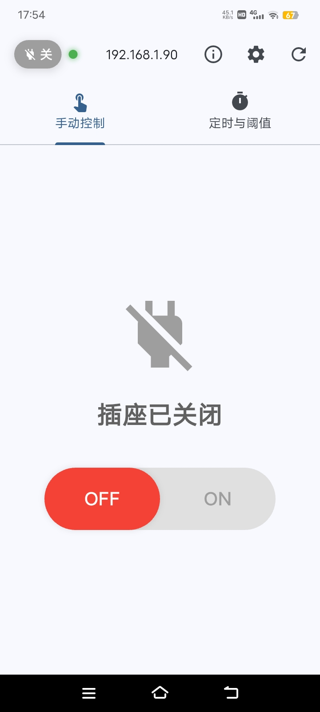
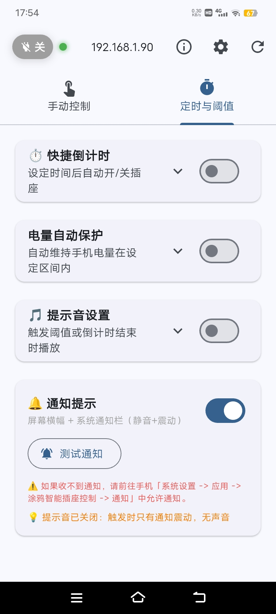
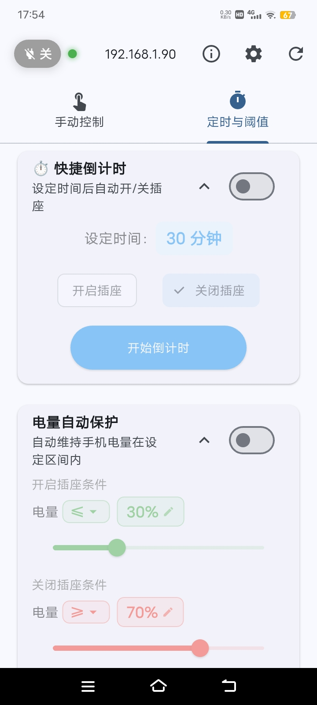
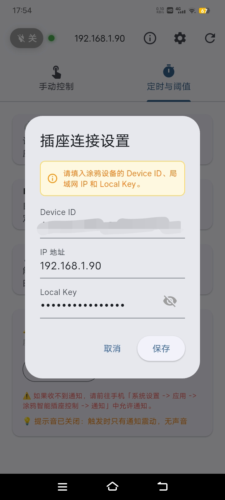

# 🔌 涂鸦智能插座控制 App (Plug App)

这是一个**极简、直观、纯本地**的涂鸦（Tuya）WiFi 智能插座控制 App。旨在为作者自己家人日常使用设计，作者什么也不会，就连这个md文件也是DeepSeek生成的。最后竟然真的弄成了，反正我自己是能用的，发到这里来分享一下。文件数量很少，可以发给AI让她们分析一下，以便实现你自己的需求。

> 👤 **作者**：shgvge
> 🤖 **代码生成**：本项目 100% 由 DeepSeek 协助生成与优化
> 🔗 **B站主页**：[https://space.bilibili.com/1539184586](https://space.bilibili.com/1539184586)

---

## 📸 界面预览

  
  
  
  

---

## ✨ 核心特性

* **🚀 纯本地局域网直连**：不经过任何云端服务器，基于 `tinytuya` 协议，极低延迟，保护隐私。
* **🔋 手机电量自动保护**：可设置上下限与多种运算符（`>`、`>=`、`==` 等），低于下限自动开插座，高于上限自动关，防止手机过充。
* **⏱️ 快捷倒计时**：设定时间后自动开启或关闭插座。
* **🔔 系统级通知震动**：触发阈值或倒计时结束时，弹出系统通知并伴随震动（静音设计，不打扰）。
* **🎵 自定义提示音**：支持调用手机本地音频（.mp3, .wav, .ogg 等），内置默认音效兜底。
* **🟢 全局状态指示**：顶部实时显示插座开关状态、连接状态（绿=在线，红=离线，黄=刷新中）。

---

## 🛠️ 技术栈 & 架构

* **前端框架**：Flutter (Dart)
* **底层通讯**：`tinytuya` (TCP 直连，带 3 秒强制超时防卡死)
* **状态与本地存储**：`shared_preferences`
* **通知与音频**：`flutter_local_notifications`、`audioplayers`
* **编译流水线**：**100% 全云端**（GitHub Actions），本地无需搭建任何环境，甚至不需要下载 Android Studio 即可一键打包签名 APK。

---

## ⚠️ 开源与安全须知（非常重要！）

如果你要将此项目设为 **Public（公开）**，请务必阅读以下安全铁律：

1. **切勿泄露设备密钥**：涂鸦插座的 `Local Key` 等同于插座的控制密码。在 `config.json` 中，`device` 字段的三个值**必须留空**。
2. **切勿上传签名文件**：`release-key.jks` 签名文件绝对不能提交到代码仓库！请在 `.gitignore` 中忽略它。
3. **推荐做法**：GitHub 仓库保持 Public 供大家学习；如果你自己要用，Fork 一份设为 Private（私有），在私有分支的 `config.json` 里填上你的设备信息，生成的 App 家人装上就能直接用。

---

## 📦 如何编译（无需本地环境）

本项目借助 GitHub Actions 实现了“一键云编译”，编译时间10分钟左右。

### 1. 配置编译密钥 (Secrets)
在你的 GitHub 仓库中，进入 `Settings` -> `Secrets and variables` -> `Actions`，添加以下 4 个 Secret：
* `KEYSTORE_BASE64`：你的签名文件 `release-key.jks` 转换为 Base64 后的字符串。
* `KEYSTORE_PASSWORD`：签名文件密码。
* `KEY_ALIAS`：签名别名（如 `plug_app`）。
* `KEY_PASSWORD`：签名密码。

### 2. 设备配置与打包
*   **App 默认设备信息**：修改根目录下的 `config.json` 中的 `device` 字段，填入你的涂鸦插座信息（**开源请留空**）。
*   **编译配置**：无需修改任何文件。在 GitHub 仓库的 `Actions` 页面，点击 `Run workflow`，在弹窗中勾选需要的架构和功能即可。

---
*如果这个项目对你有帮助，欢迎来我的 B站主页 支持一下！*